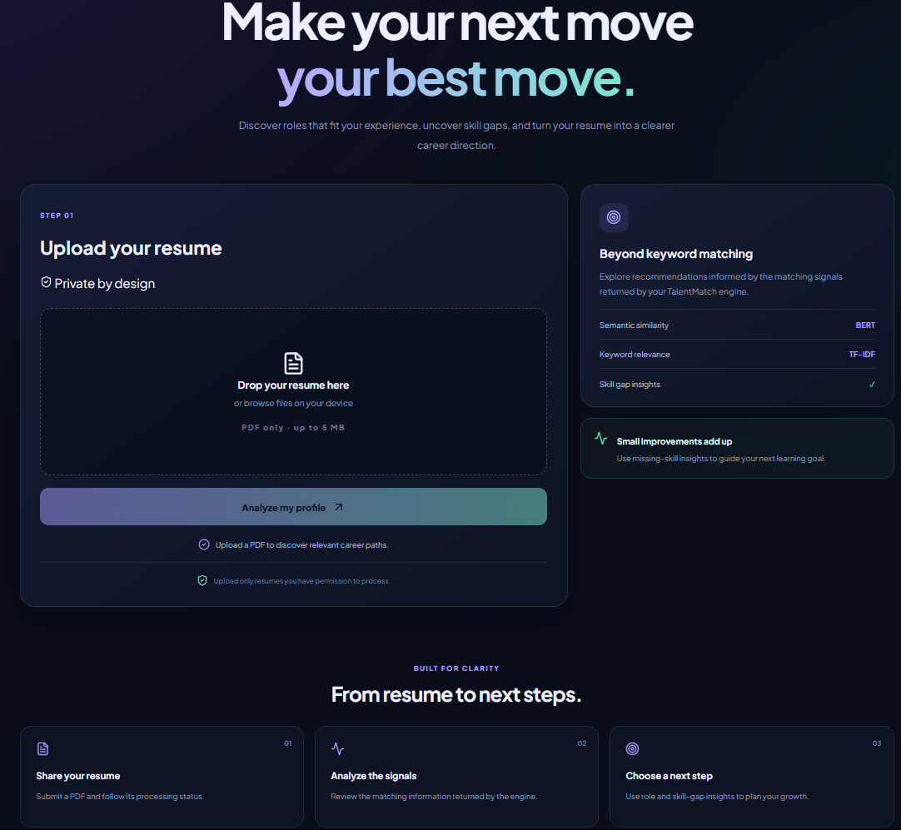
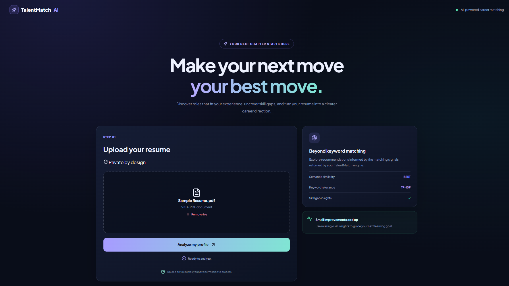
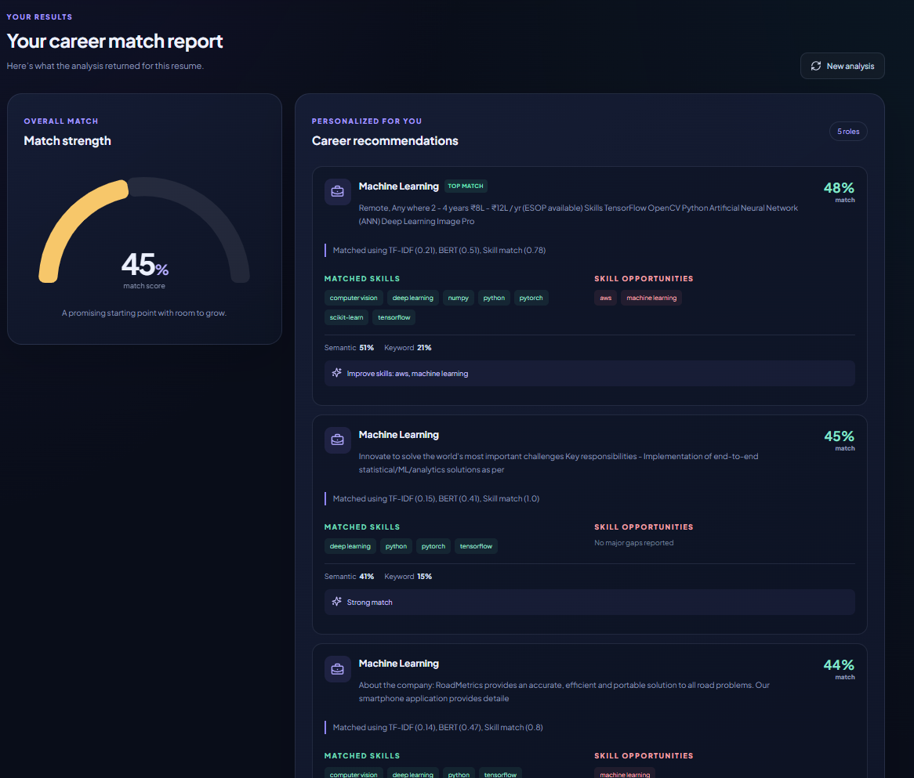
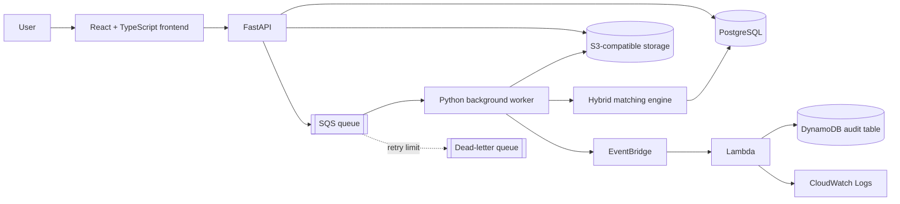

# TalentMatch Cloud
### AI-powered resume–job matching with asynchronous, cloud-integrated processing

TalentMatch Cloud extends the TalentMatch resume–job matching application with a durable upload workflow, background processing, local cloud-service emulation, and infrastructure-as-code.

The application analyzes a PDF resume and returns ranked job recommendations with an overall match score, semantic and keyword similarity signals, matched skills, missing skills, and explanations. The cloud extension separates the user-facing upload request from the more expensive recommendation workload: the API stores and queues a resume, while a background worker processes it and persists the result.

> **Deployment status:** The application and cloud workflow were exercised locally using Docker Compose and Floci. The separate `terraform/aws/` configuration was validated, but it has **not** been applied to a real AWS account. Do not interpret local emulator results as proof of a production AWS deployment.

---

## Product screenshots

### Resume upload


### Upload selected


### Career match report


---

## What it does

- Accepts PDF resumes through a web interface and FastAPI endpoint.
- Validates the uploaded file (PDF extension/signature, non-empty content, readable text, and a 5 MB size limit).
- Extracts resume text and evaluates it against the job-description dataset.
- Combines TF-IDF keyword similarity, Sentence Transformer semantic embeddings, and skill overlap.
- Returns ranked recommendations with match components, matched skills, missing skills, and improvement suggestions.
- Stores uploaded files in S3-compatible object storage and queues processing through SQS.
- Uses a separate Python worker to process queued resumes asynchronously.
- Stores upload status and recommendation results in PostgreSQL.
- Publishes a completion event for downstream Lambda processing, audit storage, and logs.
- Provides a React + TypeScript frontend and FastAPI REST API.

## Architecture at a glance



More detailed diagrams are available in:

- [System architecture](docs/architecture/system-architecture.md)
- [Upload processing sequence](docs/architecture/upload-processing-flow.md)
- [Local cloud infrastructure](docs/architecture/cloud-infrastructure.md)

## Technology stack

| Area | Technologies |
|---|---|
| Frontend | React 19, TypeScript, Vite |
| API | Python, FastAPI, Pydantic |
| AI / NLP | scikit-learn TF-IDF, Sentence Transformers (`all-MiniLM-L6-v2`), cosine similarity, rule-based skill extraction |
| Data | PostgreSQL 16, JSONB |
| Async processing | Python worker, Amazon SQS-compatible queue, dead-letter queue |
| Object storage | Amazon S3-compatible storage |
| Events | EventBridge-compatible event bus, AWS Lambda |
| Audit / logs | DynamoDB-compatible table, CloudWatch-compatible logs |
| Containers | Docker, Docker Compose |
| Infrastructure as code | Terraform |
| Local cloud environment | Floci |

## Matching methodology

The recommendation engine builds TF-IDF vectors and semantic embeddings for the resume and job descriptions, extracts skills, calculates skill overlap, and ranks job records by a weighted score.

The current scoring expression in `core/recommendation/recommender.py` is:

\[
\text{Match Score} = 0.30(\text{TF-IDF}) + 0.50(\text{Semantic}) + 0.20(\text{Skill})
\]

The engine returns up to five recommendations by default. The overall score is the average of the returned top recommendations, expressed as a percentage.

**Implementation note:** `backend/config.py` currently declares TF-IDF/BERT/skills weights of 0.40/0.40/0.20, while the recommender function uses 0.30/0.50/0.20 directly. The function is the active calculation path; this configuration inconsistency should be reconciled in a future cleanup before treating the weights as centrally configurable.

See [AI matching engine](docs/implementation/ai-matching-engine.md).

## Asynchronous processing

1. The frontend submits a PDF to `POST /upload-resume`.
2. FastAPI validates the file and extracts text to reject unreadable resumes.
3. The API creates a PostgreSQL upload record, stores the PDF in S3-compatible storage, and enqueues an upload identifier in SQS.
4. The API returns HTTP `202 Accepted` with an upload ID and status URL.
5. The worker long-polls the queue, claims the upload record, downloads the PDF, runs the matching engine, and stores the result.
6. The worker publishes a completion event. EventBridge routes it to a Lambda function.
7. The Lambda writes an audit record to DynamoDB and emits logs.
8. The frontend can poll the upload-status endpoint to retrieve the completed result.

The queue is configured with a dead-letter queue redrive policy. A message is not deleted by the worker when processing raises an exception; SQS retry/redrive behaviour is responsible for eventual DLQ movement.

## API endpoints

| Method | Endpoint | Purpose |
|---|---|---|
| `GET` | `/` | API health/message |
| `POST` | `/upload-resume` | Validate, store, and queue a PDF resume |
| `GET` | `/uploads` | List recent upload records |
| `GET` | `/uploads/{upload_id}` | Retrieve upload status/result |
| `POST` | `/recommend` | Generate recommendations from supplied resume text |
| `POST` | `/extract-skills` | Extract skills from text |
| `POST` | `/compare-skills` | Compare resume and job skill lists |
| `POST` | `/career-advice` | Request generated career guidance |

Interactive API documentation is available at `/docs` when the API is running.

## Run locally

### Prerequisites

- Docker Desktop with Docker Compose
- Git
- Floci running locally and exposing its AWS-compatible endpoint on port `4566`
- Optional: a Gemini API key if using the generated career-advice endpoint

### Start the application

From the repository root:

```bash
docker compose up --build
```

The Compose stack starts the FastAPI application, background worker, React frontend, and PostgreSQL database. The Compose environment is configured to reach Floci at `host.docker.internal:4566`.

Typical local URLs:

| Component | URL |
|---|---|
| Frontend | http://localhost:5173 |
| FastAPI | http://localhost:8000 |
| Swagger UI | http://localhost:8000/docs |
| PostgreSQL | localhost:5432 |

The Floci service and its UI are managed separately from the application Compose file in the tested setup. Start/configure Floci before submitting a resume.

### Configuration and secrets

- Do not commit `.env`, API keys, credentials, Terraform state, or real resume documents.
- Use `.env.example` for documented variable names and placeholders only.
- The Compose file contains local-development database credentials and is not a production secret-management pattern.
- Configure Gemini credentials locally only if that optional feature is being used.

## Infrastructure as code

Terraform is separated into different roots:

- `terraform/floci/` — local Floci resources used for the emulator workflow.
- `terraform/aws/` — separate configuration intended for real AWS resources.
- `terraform/` — earlier/root-level Terraform configuration retained in the project.

The AWS Terraform configuration includes definitions for S3, SQS and DLQ, Lambda, EventBridge, DynamoDB, CloudWatch Logs, IAM, networking, and an optional EC2 resource (disabled by default). It does not deploy the FastAPI/worker containers or automatically migrate PostgreSQL.

See [Terraform infrastructure](docs/implementation/terraform-infrastructure.md). Review the plan, permissions, region, and estimated costs before any real AWS apply.

## Verification evidence

The recorded local integration run submitted a synthetic PDF and received HTTP `202`. The upload moved from `queued` to `processing` to `completed`; the object was present in the local S3-compatible bucket, the worker logged completion, the completion event reached the Lambda/audit path, and the associated audit log was visible.

The recorded test suite run reported **25 passed** (with 3 warnings). These are local test results, not production availability or AWS deployment claims.

See [Testing and verification](docs/testing/test-results.md) and [Integration test walkthrough](docs/testing/integration-testing.md).

## Repository map

```text
backend/             FastAPI API, persistence, storage, queue, worker, events
core/                Resume/job processing and recommendation engine
data/                Job-description dataset
evaluation/          Evaluation and analytics utilities
frontend/            Earlier HTML/CSS/JavaScript frontend
frontend-v2/         Current React + TypeScript + Vite frontend
tests/               Automated tests
terraform/floci/     Local Floci infrastructure
terraform/aws/       Real-AWS Terraform configuration (not applied)
docs/                Project documentation, diagrams, and screenshots
```

## Current limitations and production hardening

- The AWS Terraform root is validated but has not been deployed to AWS.
- Floci emulates AWS APIs; emulator success does not guarantee identical behaviour in AWS.
- The local EC2 demonstration used a Docker-backed Ubuntu environment. SSH was demonstrated, but the emulator's instance metadata/role-credential path was not fully functional; do not claim production EC2 instance-profile access was verified.
- The API currently enables permissive CORS and uses local development credentials in Compose. Restrict origins, externalize secrets, and use production-grade authentication/authorization before public deployment.
- Database schema changes are applied through startup SQL statements rather than a versioned migration framework.
- The recommender's active scoring weights and the constants in `backend/config.py` are inconsistent (see above).
- The completion-event publisher's return value is not currently used by the worker to alter processing status. Consider durable event retry/outbox handling.
- The current integration evidence is based on a synthetic test resume and local job data; it is not a validated hiring prediction or benchmark of real-world recruitment outcomes.

## Credits and project history

TalentMatch began as a collaborative academic project. The original team README records contributions by Affaan Shaikh, Sayali, and Vivan across architecture, AI/matching, evaluation, skill extraction, recommendation, frontend, and backend integration. This repository documents the cloud-focused extension and subsequent application work.

Before publicly redistributing any copied team-project source, confirm that the original collaborators agree and that the source has an appropriate license. The original repository did not contain a license in the reviewed snapshot; attribution alone does not grant redistribution rights.

## License

No license is currently specified. Until a license is added with the necessary rights-holder approval, all rights are reserved by default.

## Dataset Attribution

TalentMatch uses the [Job Title and Job Description Dataset](https://www.kaggle.com/datasets/kshitizregmi/jobs-and-job-description), published by kshitizregmi on Kaggle.

- File: `job_title_des.csv`
- License: [CC0 1.0 Universal](https://creativecommons.org/publicdomain/zero/1.0/)
- Purpose: Provides job titles and descriptions for resume-to-job matching and recommendations.

The dataset is distributed under CC0 1.0. Attribution is provided to acknowledge the original publisher.
