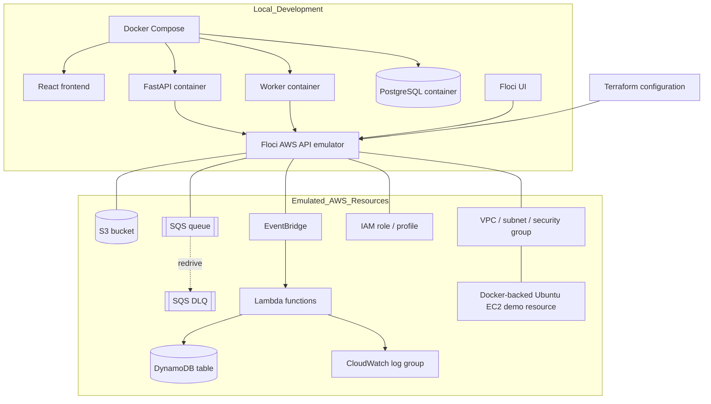

# Cloud infrastructure layout

The local integration environment uses Floci to emulate AWS-compatible services. The application containers run through Docker Compose and connect to Floci's endpoint.

## Local resources recorded in the audit

- S3 bucket: `talentmatch-resumes-local`
- SQS queue: `talentmatch-local-resume-processing`
- SQS dead-letter queue: `talentmatch-local-resume-processing-dlq`
- EventBridge rules: `talentmatch-resume-completed-test` and `talentmatch-resume-completed-local`
- Lambda functions: `talentmatch-lambda-smoke-test` and `talentmatch-resume-completed-local`
- DynamoDB table: `talentmatch-resume-audit-local`
- CloudWatch log group: `/aws/lambda/talentmatch-resume-completed-local`

The local EC2 demonstration used a Docker-backed Ubuntu 24.04 environment with SSH exposed on host port 2200. The emulator did not fully provide EC2 instance metadata credentials for the container. This is a local demonstration limitation and must not be represented as a fully verified AWS EC2 deployment.

## Local emulator and real AWS are separate

`terraform/floci/` targets the local Floci environment. `terraform/aws/` is a separate AWS configuration that was validated but not applied to an AWS account. A successful Terraform validation checks configuration syntax/provider compatibility; it does not create the resources.
