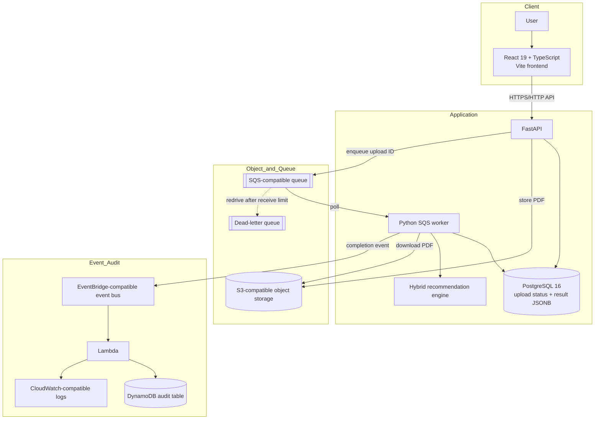

# System architecture

TalentMatch Cloud is composed of a browser frontend, a synchronous API layer, persistent data/object storage, an asynchronous worker, and an event-driven audit path.

## Component responsibilities

| Component | Responsibility |
|---|---|
| React frontend | Resume selection/upload, progress/status display, recommendation report |
| FastAPI | Input validation, upload orchestration, synchronous utility endpoints, status/result APIs |
| PostgreSQL | Upload metadata, processing state, score, recommendation result, errors, timestamps |
| S3-compatible storage | Stores original uploaded PDF objects |
| SQS-compatible queue | Decouples upload acceptance from recommendation processing |
| Python worker | Claims jobs, downloads PDFs, runs AI matching, persists results, publishes completion event |
| DLQ | Holds messages that exceed the configured retry/redrive threshold |
| EventBridge | Routes resume-completed events to downstream targets |
| Lambda | Handles completion event and writes audit information |
| DynamoDB | Stores audit records |
| CloudWatch-compatible logs | Captures Lambda audit/processing log entries |
| Terraform | Defines local-emulator and intended AWS infrastructure resources |

## Persistence model

The `resume_uploads` table includes a UUID identifier, original filename, object key, file size, status, overall score, JSONB result, error message, creation timestamp, and processing-start timestamp.

The worker uses an atomic database update to claim a queued upload. A processing lease older than four minutes can be reclaimed, helping recover work left in a processing state after a worker interruption.

## Boundaries

The Terraform AWS root provisions infrastructure definitions; Docker Compose runs the local application services. The current Terraform AWS stack does not deploy the API/worker containers or migrate PostgreSQL automatically.
