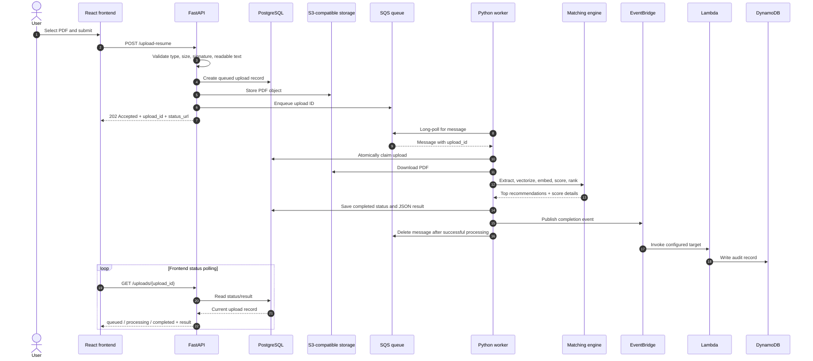

# Resume upload and processing sequence

## Retry behaviour

If worker processing raises an exception, the worker logs the error and does not delete the SQS message. SQS can redeliver it after the visibility timeout. The queue's redrive policy moves a message to the configured dead-letter queue after the configured receive limit. This is queue-managed retry/redrive behaviour, not a custom worker-side DLQ transfer.

## API acceptance versus completion

The upload endpoint returns `202 Accepted` once the upload has been accepted and queued. It does not wait for the matching engine to finish. The client uses the returned upload identifier/status URL to check progress and retrieve the result later.
